# Printing and assembly

**English** | [Deutsch](de/aufbau.md)

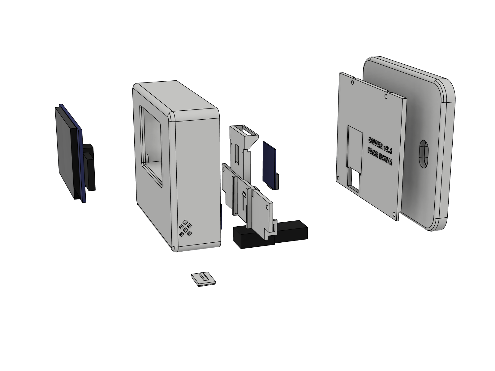

**Prefer it in 3D?** The [interactive assembly guide](https://tobi136b.github.io/co2-wall-sensor/assembly.html) walks through all 12 steps. Turn the device, take it apart with the slider, look through the housing and see which part comes next.

[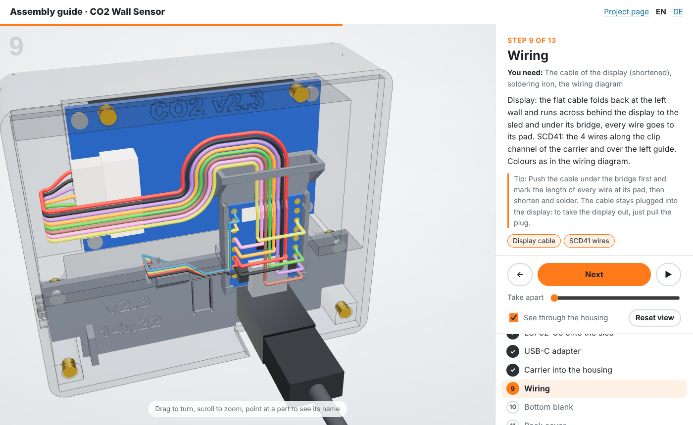](https://tobi136b.github.io/co2-wall-sensor/assembly.html)

## 1. 3D printing

Every part carries the enclosure version as a bold engraved label on a hidden face (the carrier also its sensor profile), large enough to print cleanly with a 0.4 mm nozzle.

| Part | File | Orientation | Notes |
|------|------|-------------|-------|
| Housing | [`housing.stl`](../cad/stl/housing.stl) | front face down | The front lies on the bed (a textured PEI sheet looks great). A 45° foot on the front edge prevents elephant foot. No supports. |
| Sensor carrier | [`sensor_carrier_14x22.stl`](../cad/stl/sensor_carrier_14x22.stl) or [`sensor_carrier_15x20.stl`](../cad/stl/sensor_carrier_15x20.stl) | standing on its lower edge | **Matching your SCD41 board**, see [measure your sensor](measure-sensor.md). Printed on edge the rails become vertical channels, both spring tongues grow upwards and the cable bridge prints without support. Use a 5 mm brim. |
| Back cover | [`back_cover.stl`](../cad/stl/back_cover.stl) (cable to the back) or [`back_cover_closed.stl`](../cad/stl/back_cover_closed.stl) (cable to the bottom) | inside face down | Label "FACE DOWN". Rail points up, no supports. |
| Bottom blank | [`bottom_blank.stl`](../cad/stl/bottom_blank.stl) | outer face down | Only for the cable to the back: closes the slot in the bottom flush. |
| Wall plate | [`wall_plate.stl`](../cad/stl/wall_plate.stl) | **front face down** | The front gets the bed surface. Printed the other way round, the 78 mm recess for the box rim would have to be bridged. |
| Desk stand | [`desk_stand.stl`](../cad/stl/desk_stand.stl) | on its side | Printed on its side the rail is strongest. |

**Recommended settings:** PETG, 0.2 mm layers, 3 walls, 20 % gyroid infill, seam position "rear" or "aligned". PLA works too but may soften in summer behind a sunny window.

**Two colours:** housing in matte black or anthracite, wall plate in the colour of your light switches (usually pure white). The result looks like a switch insert in its frame.

**Fit too tight or too loose?** All sliding and plugged fits depend on one value, `FIT` (0.4 mm per side). Change it in Fusion under *Modify > Change Parameters*, run the script again and print the affected part. See [design notes](design.md#parameters-in-fusion).

## 2. Fasteners: one screw type for everything

| Qty | Part | Where |
|----:|------|-------|
| 10 | Heat-set insert **M2 × 3**, outer diameter 3.0 or 3.2 mm (hole Ø 2.9 × 3.4 mm fits both) | 4 display, 4 back cover, 2 sensor carrier |
| 10 | Button head screw **M2 × 4**, ISO 7380, hex socket 1.3 mm | same positions |
| 2 | Screw **M4** with 6 mm wall plug, pan head or countersunk | wall plate |

The wall plate has slots 5 mm wide with 3 mm play up and down and a 45° seat, so pan heads and countersunk heads both sit below its face. The two screws of a flush wall box (60 mm apart) fit the same slots. Nothing in the device is glued.

## 3. Choose the cable exit

Both ways use the same housing, only the back cover differs:

| Cable | What you need | Use |
|-------|---------------|-----|
| **To the back** | 90° USB-C adapter (plug to socket) in the socket of the ESP32-C3, any USB-C cable plugged into it, back cover with hole, bottom blank | flush wall box and **always on the desk stand** |
| **To the bottom** | straight USB-C plug, overmould at most 12.5 × 7 mm, closed back cover | cable on the wall surface, power bank below the device |

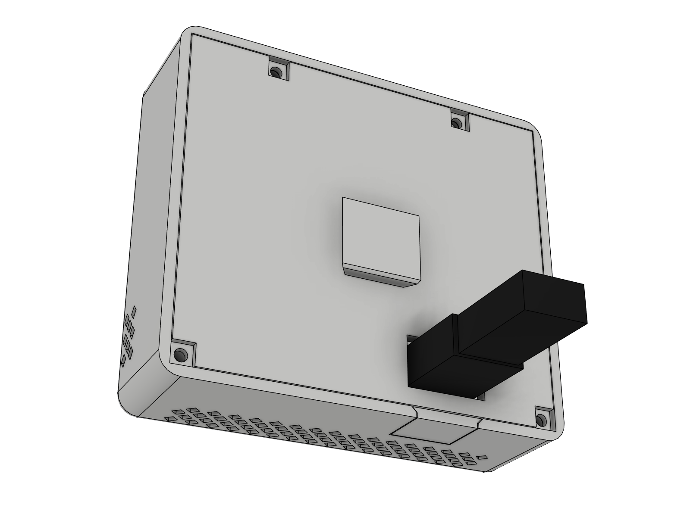 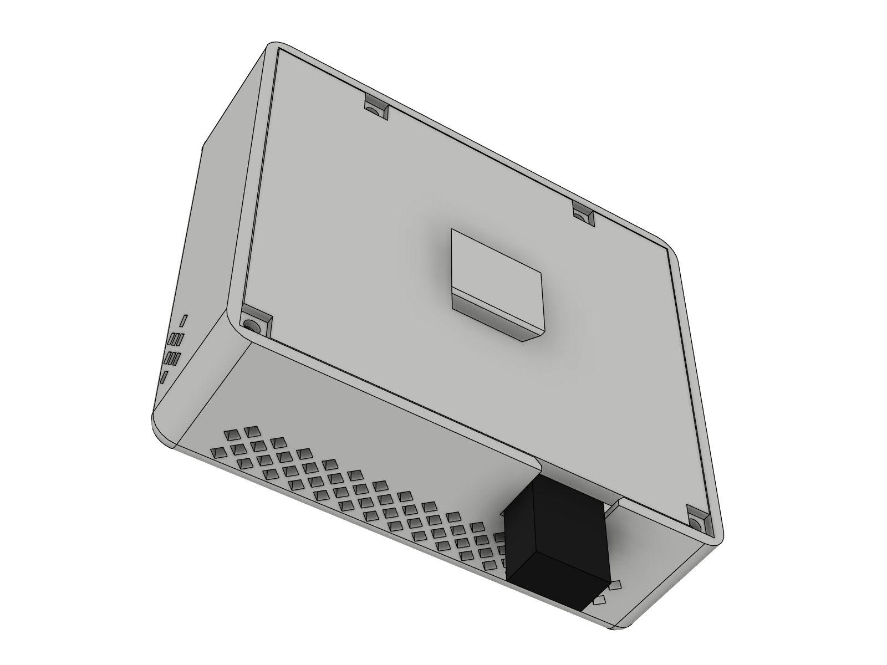

The adapter points to the wall and leaves through the hole in the back cover, the cable goes straight through the passage of the wall plate into the box. The slot in the bottom wall is then closed by the bottom blank: it slides in from the back, its slanted flanks keep it from falling out and the back cover holds it in place. A straight plug instead is laid into this slot from the back, and the closed back cover keeps the back tidy.

The hole fits the measured sonero adapter (body 19.9 × 12.9 × 8.4 mm) with 1 mm play all around. For a bulkier adapter change `ADAPTER_W`, `ADAPTER_T` and `ADAPTER_L` in Fusion, see [design notes](design.md#parameters-in-fusion).

## 4. Step by step

**Before you start, have at hand:** soldering iron with a fine tip, hex key 1.3 mm, small flat screwdriver, side cutter. All 12 steps are also in the [3D assembly guide](https://tobi136b.github.io/co2-wall-sensor/assembly.html), where you can turn every step and take the device apart.

<!-- steps:start (generated from site/assembly_steps.yaml) -->

### Step 1 of 13: The housing

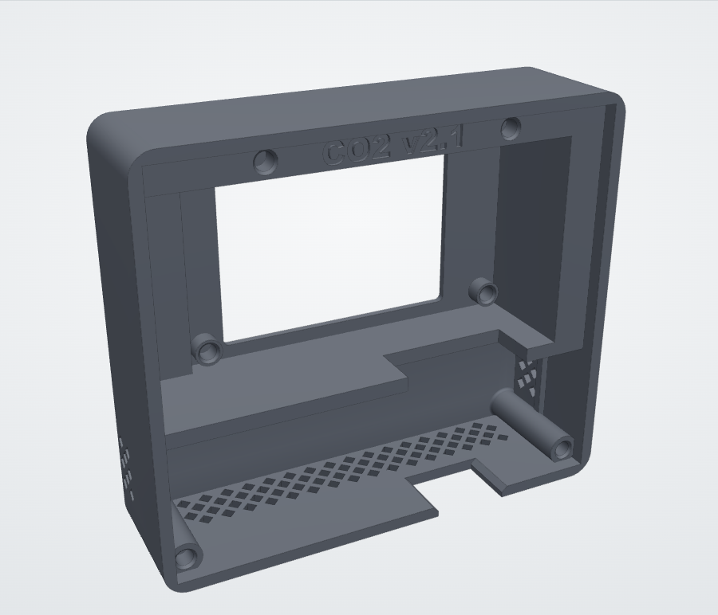

**You need:** Printed housing

Printed front face down. You look at it from the back, the side that later faces the wall. Right and left in this guide are always seen from the back, like here. ([see it in 3D](https://tobi136b.github.io/co2-wall-sensor/assembly.html#step-1))

> **Tip:** No supports needed. Remove the brim and check that the four cover seats in the corners are clean.

### Step 2 of 13: 10 heat-set inserts

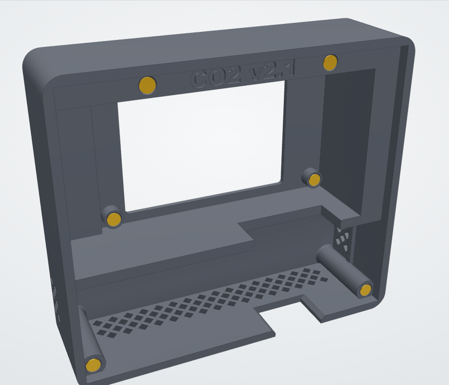

**You need:** 10 heat-set inserts M2 × 3, soldering iron at 200 to 220 °C

Press the M2 inserts in with the soldering iron (about 200 to 220 °C). 4 around the display bay, 4 for the back cover, 2 for the sensor carrier. The entry chamfer centres them. ([see it in 3D](https://tobi136b.github.io/co2-wall-sensor/assembly.html#step-2))

> **Tip:** Set the insert on the hole, touch it with the iron and let it sink under its own weight until it is flush. Do not push. The front behind the 4 display domes is only 1.1 mm thick: little heat, no pressure.

### Step 3 of 13: Display

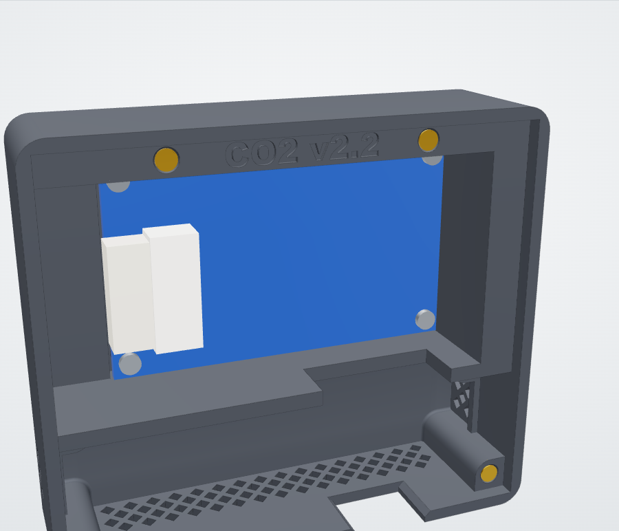

**You need:** Display with its cable plugged in, 4 screws M2 × 4, hex key 1.3 mm

Plug the supplied cable into the display first. Then glass first into the display bay, connector to the left, and 4 screws M2 × 4 through the corner holes. ([see it in 3D](https://tobi136b.github.io/co2-wall-sensor/assembly.html#step-3))

> **Tip:** It fits only one way: the connector on the left, where the bay is longer. Then the picture stands upright and the strip with the electronics hides behind the frame. Keep the protective film on the glass until the end.

### Step 4 of 13: Sensor carrier

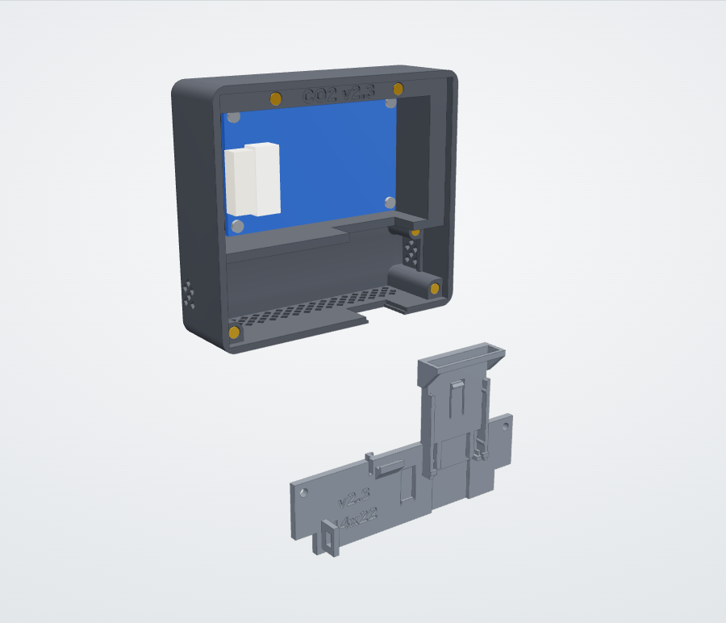

**You need:** Sensor carrier for your SCD41 board

The carrier is the removable floor of the sensor chamber and holds the ESP32-C3 on its back. Print the one that matches your SCD41 board, here the 13.5 × 21.75 mm version. ([see it in 3D](https://tobi136b.github.io/co2-wall-sensor/assembly.html#step-4))

> **Tip:** Not sure which board you have? See [measure your sensor](measure-sensor.md).

### Step 5 of 13: SCD41 into the rails

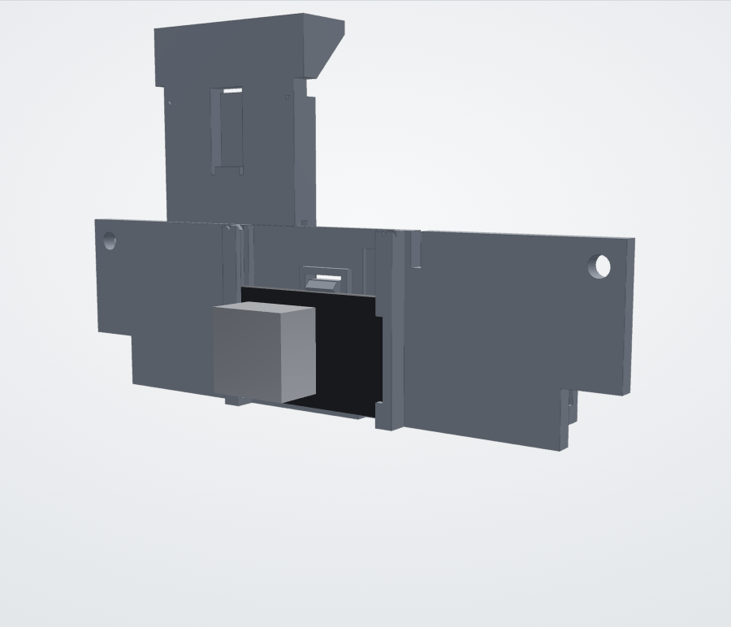

**You need:** SCD41, 4 wires of about 8 cm, soldering iron

Solder four wires of about 8 cm to the pads first, on the back of the board (the side without the sensor), and lay them flat towards the upper edge. Then slide the board in from the top, sensor towards you, pads towards the wire slot, until the spring tongue clicks over the upper edge. The wires slide along in the channel behind the pads. ([see it in 3D](https://tobi136b.github.io/co2-wall-sensor/assembly.html#step-5))

> **Tip:** To take the board out again, push the spring tongue back with a small screwdriver.

### Step 6 of 13: ESP32-C3 onto the sled

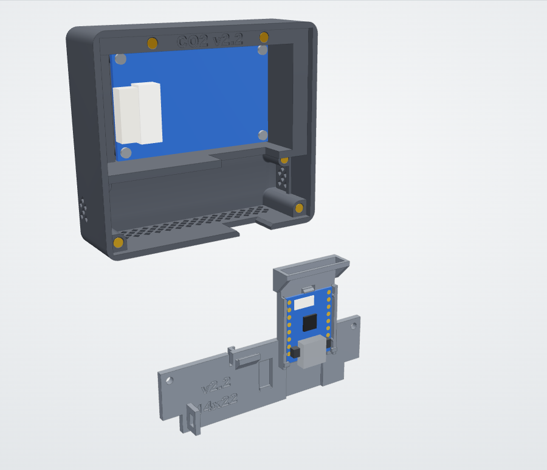

**You need:** ESP32-C3 SuperMini, soldering iron, the [wiring diagram](wiring.md)

First solder the 4 SCD41 wires to the underside of the ESP32-C3 (the side with the pin labels): GND, 3V3, GPIO0 (SDA), GPIO1 (SCL). Lead them through the notch in the left guide. Chip side up, USB-C socket down: put it on the top of the sled and slide it down between the guides until it stands on the end stops. The wires lie in the free space under the board, the hook clicks behind its upper edge. ([see it in 3D](https://tobi136b.github.io/co2-wall-sensor/assembly.html#step-6))

> **Tip:** To take it out again, press the hook down with a small screwdriver and slide the board up.

### Step 7 of 13: USB-C adapter

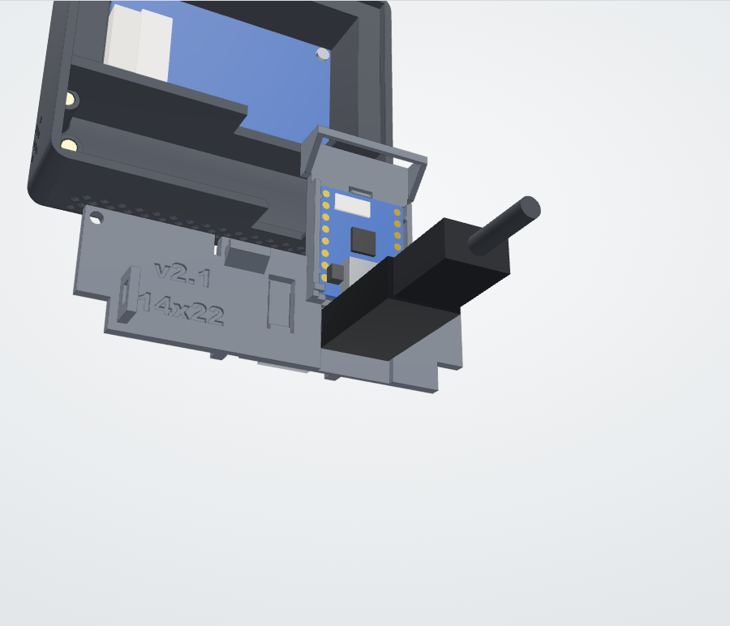

**You need:** USB-C 90° adapter (plug to socket)

Push the adapter up into the socket of the ESP32-C3, its body points to the back. The carrier is open below the socket. Later the cable goes straight back into the wall box. ([see it in 3D](https://tobi136b.github.io/co2-wall-sensor/assembly.html#step-7))

> **Tip:** Cable on the wall instead? Leave the adapter out, lay a straight plug into the slot in the bottom from the back and use the closed back cover.

### Step 8 of 13: Carrier into the housing

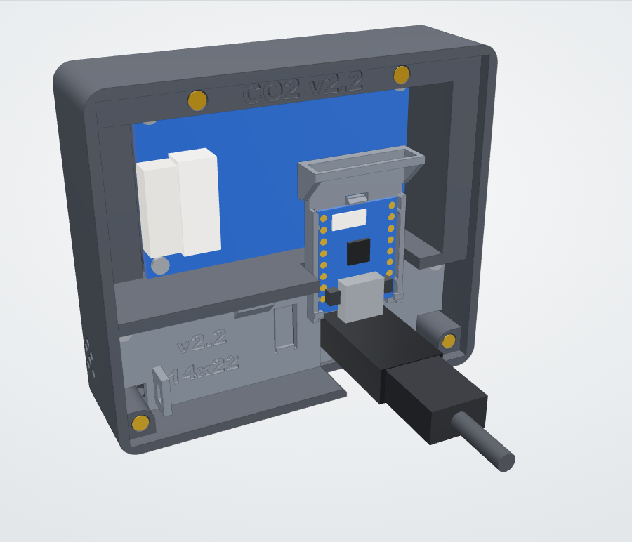

**You need:** 2 screws M2 × 4

Put the carrier onto the ledges in the chin, the sled slides over the display connector. Fix it with 2 screws M2 × 4. ([see it in 3D](https://tobi136b.github.io/co2-wall-sensor/assembly.html#step-8))

> **Tip:** Lay the four SCD41 wires into the narrow wire slot from its open end before, then the sensor chamber stays apart from the warm electronics without glue.

### Step 9 of 13: Wiring

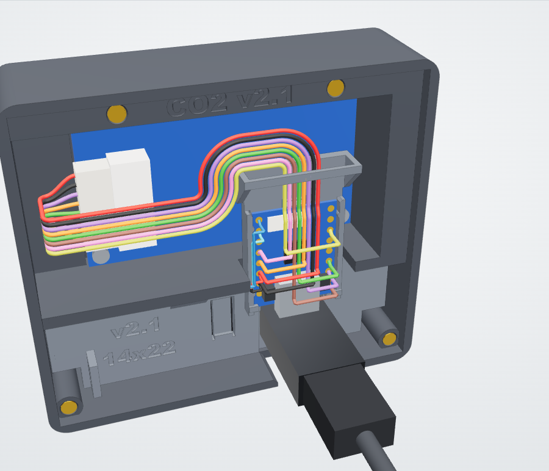

**You need:** The cable of the display (shortened), soldering iron, the [wiring diagram](wiring.md)

Display: the flat cable folds back at the left wall and runs across behind the display to the sled and under its bridge, then every wire goes down into the free space under the board and along it to its pad, soldered from below. SCD41: the 4 wires along the clip channel of the carrier and through the notch of the left guide. Colours as in the wiring diagram. ([see it in 3D](https://tobi136b.github.io/co2-wall-sensor/assembly.html#step-9))

> **Tip:** Push the cable under the bridge first and mark the length of every wire at its pad. Then press the hook down, slide the ESP32-C3 up and out, shorten the wires, solder them to its underside and slide it back in. The cable stays plugged into the display: to take the display out, just pull the plug.

### Step 10 of 13: Bottom blank

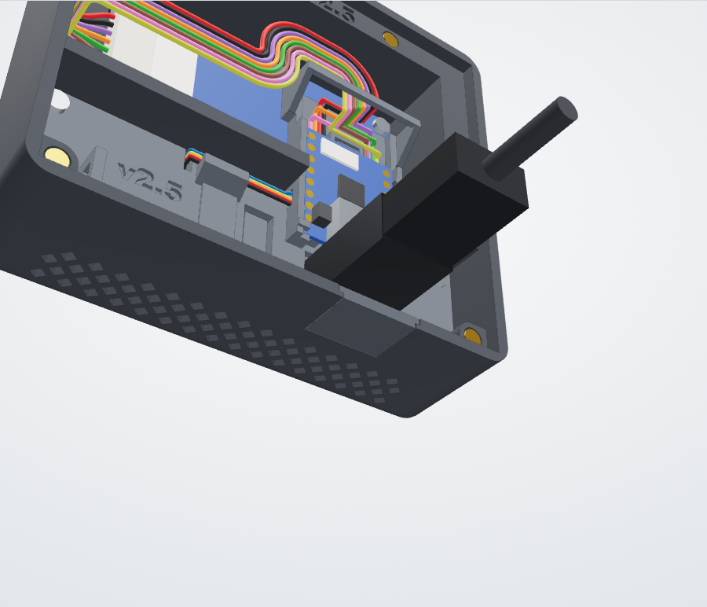

**You need:** Bottom blank

Slide the blank into the slot of the bottom wall from the back until it stops, its lug points inwards. It runs in a T-track behind the outer lip of the slot like a drawer, small ribs hold it in place, the back cover locks it. ([see it in 3D](https://tobi136b.github.io/co2-wall-sensor/assembly.html#step-10))

> **Tip:** Cable to the bottom with a straight plug instead? Leave the blank out, lay the plug into the slot from the back and use the closed back cover.

### Step 11 of 13: Back cover

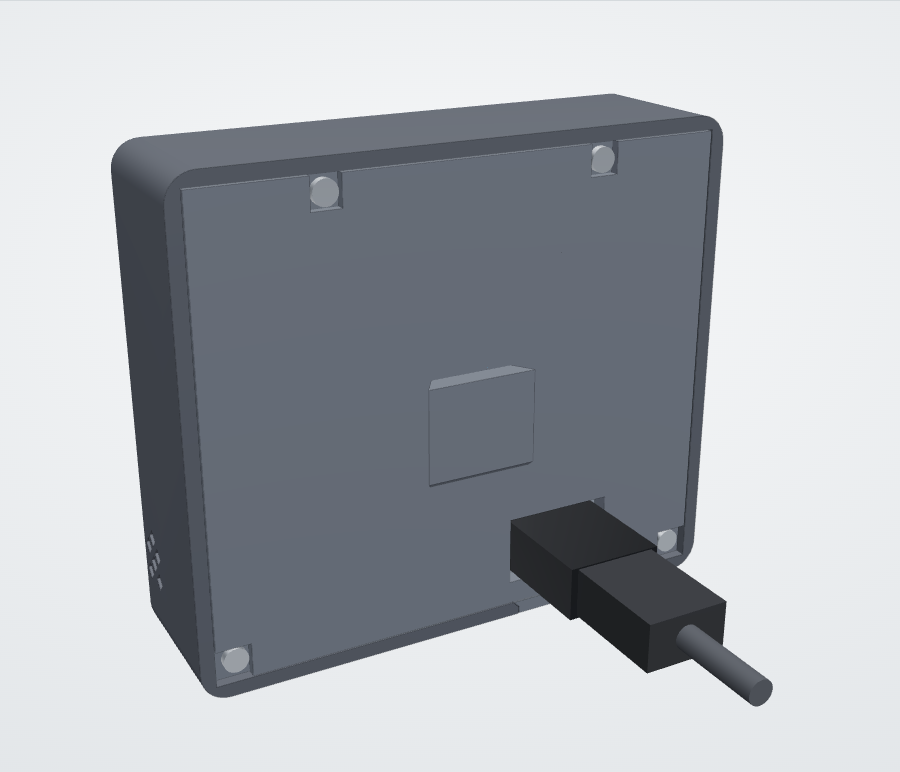

**You need:** Back cover, 4 screws M2 × 4

Put the cover into its seat, the adapter passes through its hole. Fix it with 4 screws M2 × 4. ([see it in 3D](https://tobi136b.github.io/co2-wall-sensor/assembly.html#step-11))

> **Tip:** Nothing may stick out of the back except the adapter: the heads sit below the surface, otherwise the device does not slide onto the wall plate.

### Step 12 of 13: Wall plate

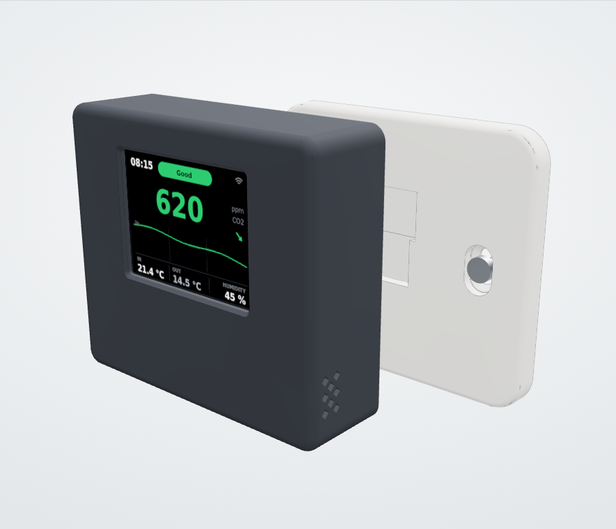

**You need:** Wall plate, 2 screws M4 with 6 mm wall plugs (or the 2 screws of a flush box)

Screw the plate to the wall, label to the wall, 60 mm between the screws. The slots give 3 mm play up and down, the recesses take pan heads and countersunk heads. ([see it in 3D](https://tobi136b.github.io/co2-wall-sensor/assembly.html#step-12))

> **Tip:** Power in a flush box: a USB power module (work on 230 V only by a qualified electrician) or a USB cable in the wall. Lead the cable through the passage of the plate.

### Step 13 of 13: Slide the device on

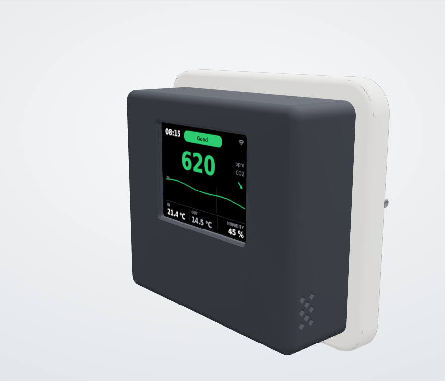

**You need:** Nothing

Hold the device in front of the plate, put the rail into the hidden window and slide it 15 mm down. Done. To remove it, slide it up and pull it off. ([see it in 3D](https://tobi136b.github.io/co2-wall-sensor/assembly.html#step-13))

> **Tip:** Plug the cable into the adapter before you put the device on the rail.

<!-- steps:end -->

## 5. Desk stand

Use the 90° adapter, the cable leaves to the back. Place the device on the rail from above and slide it down. The device leans back by 12°, a 5 mm air gap below keeps the vents free. The cable runs out through the notch at the back of the foot.

## 6. Commissioning

**The easy way:** flash the firmware from the browser on the [project page](https://tobi136b.github.io/co2-wall-sensor/), enter your WiFi in the same window and adopt the device in Home Assistant. Firmware updates then appear in Home Assistant.

**Build it yourself:**

1. Copy `esphome/secrets.yaml.example` to `esphome/secrets.yaml` and fill it in.
2. Open the ESPHome Builder in Home Assistant and add `esphome/co2-wall-sensor.yaml` (English) or `esphome/co2-wall-sensor-de.yaml` (German) together with the `common` folder.
3. Flash via USB the first time, afterwards updates go over WiFi (OTA).

**After that, in both cases:**

1. **Calibration:** put the device next to an open window for 15 minutes, then press *Calibrate SCD41 (fresh air 420 ppm)* in Home Assistant. Automatic self calibration is enabled in addition.
2. **Temperature:** after 24 hours compare with a reference thermometer and set the difference as *Temperature correction* in Home Assistant. The humidity is corrected with it.
3. **Altitude:** set *Altitude above sea level* for your place, it makes the CO2 value more exact.
4. **Night and outdoor values:** night times, dimming or switching off, the window hint and the outdoor sensor are all set in Home Assistant, see [Home Assistant](../README.md#home-assistant).
