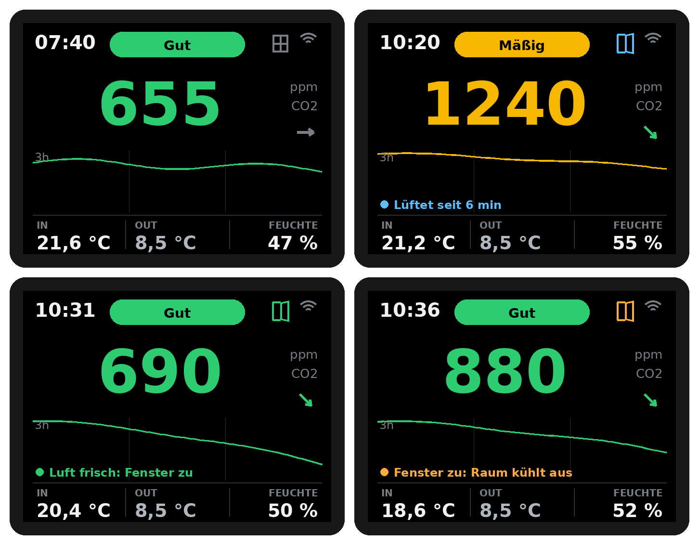

# Home Assistant Anleitung

[English](../home-assistant.md) | **Deutsch**

Schritt für Schritt vom geflashten Gerät bis zu Fensterkontakten, Außenwerten und Benachrichtigungen aufs Handy. Für nichts davon brauchst du eine neue Firmware: Jede Einstellung liegt in Home Assistant und bleibt auch nach einem Stromausfall erhalten.

Die Namen gelten für die deutsche Firmware. Mit der englischen Firmware stehen die englischen Namen in Klammern, zum Beispiel *Luft frisch unter* (*Fresh air below*).

## 1. Gerät hinzufügen

1. Firmware flashen (Projektseite, Browser-Installer) und WLAN eintragen.
2. Home Assistant meldet unter *Einstellungen > Geräte & Dienste* **Neues Gerät gefunden: CO2 Wandsensor**. **Konfigurieren** und **Absenden** klicken.
3. Gerät öffnen. Links stehen die Messwerte (CO2, Temperatur, Luftfeuchtigkeit, Luftqualität, Trend), unter **Konfiguration** die Einstellungen und unter **Diagnose** WLAN Signal und Laufzeit.

Nicht gefunden? Von Hand hinzufügen: *Integration hinzufügen > ESPHome*, Host `co2-wandsensor.local` (englisch: `co2-wall-sensor.local`) oder die IP-Adresse aus deinem Router.

## 2. Die ersten Einstellungen

Unter **Konfiguration** auf der Geräteseite:

| Einstellung | Standard | Wofür |
|---|---|---|
| Temperaturkorrektur (*Temperature correction*) | 2,0 °C | Die Elektronik wärmt das Gehäuse etwas. Gerät eine Stunde hängen lassen, mit einem Referenzthermometer vergleichen und anpassen. |
| Höhe über dem Meer (*Altitude above sea level*) | 300 m | Druckausgleich für den CO2-Wert. |
| CO2 Schwelle Gelb / Rot (*CO2 threshold yellow / red*) | 1000 / 1400 ppm | Ampel auf dem Display. Rot steuert auch *Lüften in* und den Blueprint. |
| Messintervall (*Measuring interval*) | 30 s | 5 bis 60 s. Kürzer reagiert schneller, länger wärmt den Sensor weniger. |
| Glättung (*Smoothing*) | an | Mittelwert aus aktuellem und vorherigem Messwert, beruhigt kleine Sprünge. |
| Trendpfeil ab (*Trend arrow from*) | 100 ppm/h | Ab dieser Änderung pro Stunde zeigt der Pfeil nach oben oder unten. |
| Nachtmodus, Nacht ab, Nacht bis | an, 22:00 bis 06:00 | Display nachts gedimmt (Standard 8 %) oder aus. |
| Rote Warnung auch nachts (*Red warning at night*) | an | Das Display geht an, solange der Wert rot ist. |
| Display auf dem Kopf (*Display upside down*) | aus | Dreht das Bild um 180°. |

## 3. Außenwerte

Das Display zeigt unter **OUT** die Außentemperatur, und der Fensterhinweis vergleicht innen und außen.

* **Ohne etwas einzurichten** liest das Gerät `weather.forecast_home`, die Wetter-Entität, die Home Assistant für deinen Heimatort anlegt (Integration *Meteorologisk institutt (Met.no)*). Unter *Einstellungen > Geräte & Dienste* prüfen, ob sie da ist.
* **Ein echter Außensensor ist besser.** Wie gewohnt anlernen (Zigbee, Homematic IP, Shelly, Bosch, ...). Dann *Einstellungen > Geräte & Dienste > Entitäten* öffnen, die Temperatur suchen, anklicken, auf das Zahnrad klicken und die **Entitäts-ID** auf `sensor.outdoor_temperature` setzen. Feuchte: `sensor.outdoor_humidity`. Ein paar Sekunden später zeigt das Display den Wert.
* **Außenwert auf dem Display** (*Outdoor value on the display*) ausschalten, wenn du die OUT-Spalte nicht willst.

Fensterhinweise aus den Außenwerten (*Fensterhinweis ab Innentemperatur*, Standard 24 °C, und *draußen kühler um*, Standard 3 °C): *Fenster auf: außen kühler*, *Lüften trocknet die Luft*, *Fenster zu: außen wärmer*.

## 4. Fensterkontakte

Mit einem Fensterkontakt weiß das Gerät, wann du lüftest. Die Firmware hört auf **einen Binärsensor**: eine Gruppe aller Fensterkontakte im Raum.

1. *Einstellungen > Geräte & Dienste > Helfer > Helfer erstellen > Gruppe > Binärsensor-Gruppe*.
2. Name: **CO2 Wandsensor Fenster** (englische Firmware: **CO2 Wall Sensor Window**).
3. Die Fensterkontakte des Raums hinzufügen. *Alle Entitäten* ausgeschaltet lassen, dann ist die Gruppe an, sobald ein Fenster offen ist.
4. Entitäts-ID der Gruppe prüfen: `binary_sensor.co2_wandsensor_fenster` (englisch: `binary_sensor.co2_wall_sensor_window`). Weicht sie ab, mit dem Zahnrad wie in Schritt 3 ändern.

Später ein zweites Fenster? Einfach zur Gruppe hinzufügen. Mehrere Geräte in verschiedenen Räumen? Jedes Gerät bekommt eine eigene Gruppe, und in seiner Gerätedatei steht `window_entity`.

### Was das Display zeigt

| Fenstersymbol | Hinweiszeile | Wann |
|---|---|---|
| grau, zu | (Außenhinweise wie oben) | alle Fenster zu |
| blau, offen | *Fenster offen: lüftet*, dann *Lüftet seit 6 min* | ein Fenster ist offen |
| grün, offen | *Luft frisch: Fenster zu* | CO2 unter **Luft frisch unter** (Standard 700 ppm) |
| orange, offen | *Fenster zu: Raum kühlt aus* | Innentemperatur unter **Fensterwarnung unter** (Standard 19 °C) |

Das Symbol erscheint, sobald Home Assistant die Gruppe liefert. **Fenstersymbol auf dem Display** blendet es aus, **Fensterhinweis auf dem Display** die Hinweiszeile. Die Auskühlwarnung geht vor der Frischluftmeldung, weil ein kalter Raum wichtiger ist.

## 5. Benachrichtigungen aufs Handy

Der Blueprint schickt drei Nachrichten und holt seine Grenzwerte direkt vom Gerät. Es reicht also, sie in Schritt 2 oder 4 zu ändern:

* **Lüften!**, wenn der CO2-Wert über der roten Schwelle bleibt und **kein Fenster offen ist**. Machst du das Fenster zu früh zu, kommt die Erinnerung wieder.
* **Luft frisch, Fenster kann zu**, wenn das Fenster offen ist und der CO2-Wert unter *Luft frisch unter* fällt.
* **Fenster zu, der Raum kühlt aus**, wenn das Fenster offen ist und der Raum unter *Fensterwarnung unter* fällt.

Einrichten:

1. Die **Home Assistant Companion App** aufs Handy installieren und einmal anmelden.
2. Blueprint importieren:

   

   Oder von Hand: *Einstellungen > Automationen & Szenen > Blueprints > Blueprint importieren* und `https://github.com/tobi136B/co2-wall-sensor/blob/main/homeassistant/blueprints/co2_ventilation_reminder.yaml` einfügen.
3. Den Blueprint anklicken, **Automation erstellen** und ausfüllen:

   | Feld | Auswahl |
   |---|---|
   | CO2 | *CO2 Wandsensor CO2* |
   | Temperatur | *CO2 Wandsensor Temperatur* |
   | CO2 Schwelle Rot | *CO2 Wandsensor CO2 Schwelle Rot* |
   | Luft frisch unter | *CO2 Wandsensor Luft frisch unter* |
   | Fensterwarnung unter | *CO2 Wandsensor Fensterwarnung unter* |
   | Fensterkontakt oder Gruppe | die Gruppe aus Schritt 4 (optional, ohne sie kommt nur *Lüften!*) |
   | Handy | dein Handy |
   | Lüften erst nach | so lange muss der Wert rot bleiben, Standard 5 min |

4. Jede Nachricht lässt sich abschalten und ihr Text ändern. **Speichern**.

Testen: *CO2 Schwelle Rot* kurz auf 500 ppm stellen. Nach der Wartezeit zeigt das Handy *Lüften!*. Danach zurückstellen.

## 6. Dashboard

Fertige Karten mit Tacho, Fenster, Hinweis und 24 Stunden Verlauf: [`dashboard_karte.yaml`](../../homeassistant/de/dashboard_karte.yaml) (englisch: [`dashboard_card.yaml`](../../homeassistant/dashboard_card.yaml)). *Dashboard bearbeiten > Karte hinzufügen > Manuell*, einfügen, speichern. Weitere Automationen als Beispiel: [`automationen.yaml`](../../homeassistant/de/automationen.yaml).

## Wenn etwas nicht klappt

* **Kein Fenstersymbol:** Die Gruppe fehlt oder hat eine andere Entitäts-ID (Schritt 4), oder der Schalter *Fenstersymbol auf dem Display* ist aus.
* **OUT bleibt leer:** Weder `sensor.outdoor_temperature` noch `weather.forecast_home` vorhanden, siehe Schritt 3.
* **Keine Benachrichtigung:** Die Companion App braucht auf dem Handy die Erlaubnis für Mitteilungen. Den Ablauf der Automation prüfen (*Automationen > die Automation > Traces*).
* **CO2 bleibt an frischer Luft hoch:** Nach 5 Minuten draußen oder am offenen Fenster *SCD41 kalibrieren (Frischluft 420 ppm)* drücken.
