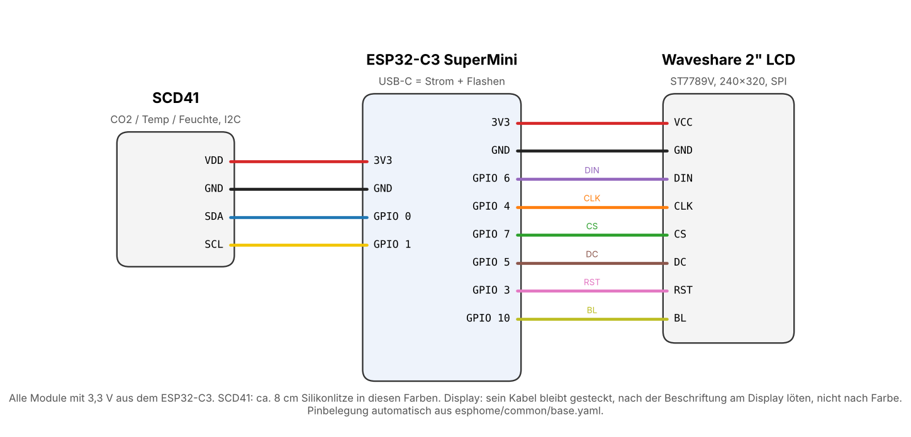

# Verdrahtung

[English](../wiring.md) | **Deutsch**

Alle Module laufen mit 3,3 V direkt aus dem ESP32-C3 SuperMini. Strom kommt über die USB-C-Buchse des ESP.

## ESP32-C3 SuperMini zu Waveshare 2inch LCD (SPI)

| LCD | Ader | ESP32-C3 | Funktion |
|-----|------|----------|----------|
| VCC | lila   | 3V3      | Versorgung 3,3 V |
| GND | weiß   | GND      | Masse |
| DIN | grün   | GPIO6    | SPI MOSI |
| CLK | orange | GPIO4    | SPI Takt |
| CS  | gelb   | GPIO7    | Chip Select |
| DC  | blau   | GPIO5    | Daten / Kommando |
| RST | braun  | GPIO3    | Reset |
| BL  | grau   | GPIO10   | Hintergrundlicht (PWM, dimmbar) |

Die Farben sind die des mitgelieferten Waveshare-Kabels. Zur Sicherheit an der Beschriftung der Displaybuchse prüfen: lila an VCC, grau an BL.

## ESP32-C3 SuperMini zu SCD41 (I2C)

| SCD41 | Litze | ESP32-C3 | Funktion |
|-------|-------|----------|----------|
| VDD   | rot     | 3V3      | Versorgung 3,3 V |
| GND   | schwarz | GND      | Masse |
| SDA   | blau    | GPIO0    | I2C Daten |
| SCL   | gelb    | GPIO1    | I2C Takt |

Die Farben stammen aus dem Silikonlitzen-Set der Stückliste. Blau und Gelb gibt es auch am Displaykabel (DC und CS): beim Löten die beiden Kabel nicht verwechseln.

## Warum genau diese Pins?

* **GPIO2, GPIO8 und GPIO9** sind Strapping-Pins des ESP32-C3 (GPIO8 hängt zusätzlich an der blauen LED, GPIO9 am BOOT-Taster). Sie bleiben frei, damit das Board immer sauber startet.
* **GPIO18 und GPIO19** sind die USB-Datenleitungen und bleiben ebenfalls frei.
* **GPIO10** ist PWM-fähig und dimmt das Hintergrundlicht, damit funktioniert der Nachtmodus.

Der Plan wird mit `python tools/wiring.py` direkt aus `esphome/common/base.yaml` erzeugt. Wer Pins in der YAML ändert, erzeugt den Plan einfach neu.

## Löten

Alle Adern werden **von unten** angelötet, also auf der Seite, die zum Träger zeigt. Dahinter ist genug Platz für Lötstellen und Adern, sie liegen sauber in eigenen Kanälen.

* **SCD41:** Litzen auf der Rückseite anlöten (die Seite ohne Sensor). Hinter der ganzen Platine ist 1 mm Luft über den ganzen Schiebeweg, sie liegt nur an den Rändern in den Schienen auf. Hinter den Lötpunkten ist ein 4,3 mm breiter Kanal 1,6 mm tief, dort kommen die Lötstellen beim Einschieben vorbei. Oben an den Schienen helfen Einführschrägen.
* **ESP32-C3:** Adern auf der Unterseite anlöten (die Seite mit der Pinbeschriftung, ohne Bauteile). Unter der Platine ist ein 1,5 mm tiefer Freiraum, oben offen. Die Platine liegt auf der Mittelschiene der Federzunge und auf zwei kurzen Stützen. Die SCD41-Litzen kommen durch die Kerbe in der linken Führung, die Display-Adern von oben unter der Brücke durch.
* **Reihenfolge:** SCD41-Litzen an den ESP löten, bevor er auf den Schlitten kommt. Für die Display-Adern das Kabel unter der Brücke durchschieben, Längen anzeichnen, den ESP herausschieben, löten und wieder einschieben.
* **Ausbauen:** Den Stecker am Display abziehen. Der PH2.0-Stecker passt durch die Brücke (Öffnung 18,8 × 6,1 mm), der ESP kommt mit allen Adern komplett heraus. Oder den Träger losschrauben und alles zusammen herausnehmen.
* **Sauber löten:** Nur 1 bis 1,5 mm abisolieren, Litze verdrillen und verzinnen, Pads vorverzinnen. No-Clean-Flussmittel hilft, aber nicht in die Nähe der Sensoröffnung des SCD41. Lötstellen flach halten, Drahtenden bündig abschneiden.
* **Prüfen:** Vor dem ersten Einstecken jede Ader auf Durchgang messen, vor allem 3V3 gegen GND auf Kurzschluss.

## Tipps

* **Display:** Das beiliegende PH2.0-Kabel bleibt im Display stecken. Es faltet sich an der linken Wand zurück (von hinten gesehen) und läuft hinter dem Display hinüber zum Schlitten und unter der Brücke durch, dann geht jede Ader zu ihrem Lötpunkt am ESP32-C3. Zuerst einlegen, die Längen an den Lötpunkten anzeichnen, dann kürzen und löten. Zum Ausbauen des Displays nur den Stecker ziehen.
* **SCD41:** 4 Litzen AWG 30 von ca. 8 cm. Sie liegen nebeneinander im schmalen Kabelschlitz des Sensorträgers und auf der Rückseite unter der Lippe des Kabelclips. Kleber ist nicht nötig.
* **Strom:** Durch die Litzen fließen nur Sensor und Display (im Mittel ca. 15 mA und 30 bis 60 mA). Die AWG-30-Litzen reichen dafür locker, der ESP selbst hängt direkt am USB.
* Der SCD41 zieht für wenige Millisekunden bis ca. 200 mA. Der 3,3-V-Regler des SuperMini schafft das, die Versorgungsleitungen trotzdem kurz halten.
* Alles zuerst auf dem Tisch testen, dann einbauen.
