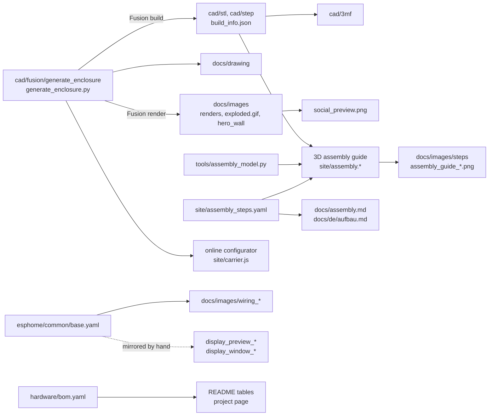

# Dependency map

What to regenerate when something changes. Every generated file has exactly one source, so the
list below is complete: change the source, run the tools of its row, commit the results.
The CI (`.github/workflows/ci.yml`) fails when a generated file is out of date where it can check it.

## When you change ...

| Source | Then run | Updates |
|---|---|---|
| **Enclosure parameters or geometry** (`cad/fusion/generate_enclosure/generate_enclosure.py`) | Fusion: run the script with `EXPORT = True` | `cad/stl/*.stl`, `cad/step/*.step`, `cad/build_info.json` |
| | `python tools/build_3mf.py` | `cad/3mf/*.3mf` |
| | `cd tools && python drawing.py` | `docs/drawing/*` |
| | Fusion: `render_views.py` (`render_views`, `render_hero`) and save the archive, then `python tools/build_gif.py FRAME_DIR` | `docs/images/*.png` renders, `docs/images/exploded.gif`, `cad/fusion/co2_wall_sensor.f3d` |
| | `python tools/social_preview.py` | `docs/images/social_preview.png` |
| | `node tools/render_steps.mjs SITE docs/images/steps` and the two screenshots of the guide | `docs/images/steps/*`, `docs/images/assembly_guide_*.png` |
| | `python tools/measure_sketch.py` (only if `SCD_*` changed) | `docs/images/measure_sensor_*.png` |
| | check: `print_check.py`, `assembly_check.py`, `configurator_check.py`, `check_repo.py` | |
| Enclosure **version** (`VERSION` in the generator) | everything of the row above, plus the badges and the hardware status in both READMEs | engraved labels, badges |
| Bought parts in the guide (`tools/assembly_model.py`) or disassembly path (`cad/fusion/hero_motion.json`) | `assembly_check.py`, step pictures; for `hero_motion.json` also the Fusion render and the GIF | guide, `exploded.gif` |
| Text of an assembly step (`site/assembly_steps.yaml`) | `python tools/assembly_docs.py`, step pictures | `docs/assembly.md`, `docs/de/aufbau.md` |
| Carrier geometry in the generator | mirror it in `site/carrier.js` and `tools/carrier_params.py`, then `configurator_check.py` | online configurator |
| **Pins** in `esphome/common/base.yaml` | `python tools/wiring.py` | `docs/images/wiring_*.png`; wire colours in `tools/assembly_model.py` |
| **Display layout** (display lambda in `base.yaml`) | mirror it in `tools/display_preview.py`, then run it | `docs/images/display_preview_*.png`, `display_window_*.png` |
| Texts on the display or entity names (`txt_*`) | the same key in all four device files (`co2-wall-sensor*.yaml`), `TEXT` in `display_preview.py`, entity tables in both READMEs and the Home Assistant guide | |
| New setting in Home Assistant | entity tables in both READMEs, `docs/home-assistant.md` and `docs/de/home-assistant.md` | |
| Blueprint (`homeassistant/blueprints/*.yaml`) | description in both READMEs and in the Home Assistant guide | |
| Example cards and automations (`homeassistant/`) | both languages (`homeassistant/de`) | |
| **Bill of materials** (`hardware/bom.yaml`) | `python tools/bom.py` | tables in both READMEs, project page |
| Project page (`tools/build_site.py`, `site/template.html`) | `python tools/build_site.py --version X --out DIR` to look at it, the release workflow publishes it | GitHub Pages |
| Any English document | its German partner (`check_repo.py` compares headings and images) | |

## Not by hand

* **Release number:** release-please sets it in `CHANGELOG.md` and in `esphome/common/base.yaml` (`x-release-please-version`). Commit messages decide: `feat` gives a minor, `fix` a patch release.
* **Firmware binaries and release assets:** the release workflow builds and attaches them.
