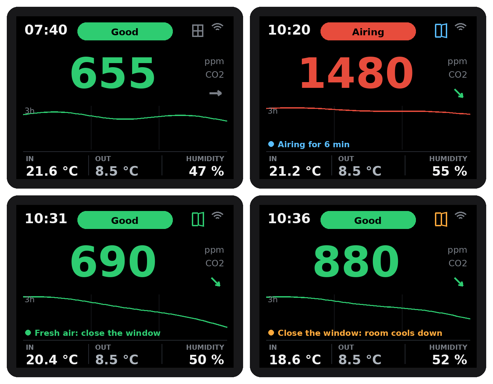

# Home Assistant guide

**English** | [Deutsch](de/home-assistant.md)

Step by step from the flashed device to window contacts, outdoor values and phone notifications. Nothing here needs new firmware: every setting lives in Home Assistant and survives a power cut.

German firmware? The names in brackets are the German ones, for example *Fresh air below* (*Luft frisch unter*).

## 1. Add the device

1. Flash the firmware (project page, browser installer) and enter your WiFi.
2. Home Assistant shows **New device discovered: CO2 Wall Sensor** under *Settings > Devices & services*. Click **Configure** and **Submit**.
3. Open the device. You see the measurements on the left (CO2, temperature, humidity, air quality, trend), the settings under **Configuration** and WiFi signal and uptime under **Diagnostic**.

Not discovered? Add it by hand: *Add integration > ESPHome*, host `co2-wall-sensor.local` (German: `co2-wandsensor.local`) or the IP address from your router.

## 2. The first settings

Under **Configuration** on the device page:

| Setting | Default | What it does |
|---|---|---|
| Temperature correction (*Temperaturkorrektur*) | 2.0 °C | The electronics warm the case a little. Hang the device for an hour, compare with a reference thermometer and adjust. |
| Altitude above sea level (*Höhe über dem Meer*) | 300 m | Pressure compensation of the CO2 value. |
| CO2 threshold yellow / red (*CO2 Schwelle Gelb / Rot*) | 1000 / 1400 ppm | Traffic light on the display. Red also drives *Ventilate in* and the blueprint. |
| Measuring interval (*Messintervall*) | 30 s | 5 to 60 s. Shorter reacts faster, longer warms the sensor less. |
| Smoothing (*Glättung*) | on | Mean of the current and the previous reading, calms small jumps. |
| Trend arrow from (*Trendpfeil ab*) | 100 ppm/h | From this change per hour the arrow points up or down. |
| Night mode, Night from, Night until | on, 22:00 to 06:00 | Display dimmed (default 8 %) or off at night. |
| Red warning at night (*Rote Warnung auch nachts*) | on | The display wakes up while the level is red, but not while a window is open. |
| Display upside down (*Display auf dem Kopf*) | off | Turns the picture by 180°. |

## 3. Outdoor values

The display shows the outdoor temperature under **OUT**, and the window hint compares inside and outside.

* **Without setting anything up** the device reads `weather.forecast_home`, the weather entity Home Assistant creates for your home location (integration *Meteorologisk institutt (Met.no)*). Check under *Settings > Devices & services* that it exists.
* **A real outdoor sensor is better.** Pair it as usual (Zigbee, Homematic IP, Shelly, Bosch, ...). Then open *Settings > Devices & services > Entities*, search for its temperature, click it, click the gear and set the **entity ID** to `sensor.outdoor_temperature`. Humidity: `sensor.outdoor_humidity`. A few seconds later the display shows it.
* Switch **Outdoor value on the display** (*Außenwert auf dem Display*) off if you do not want the OUT column.

Window hints from the outdoor values (*Window hint from indoor temperature*, default 24 °C, and *cooler outside by*, default 3 °C): *Open the window: cooler outside*, *Airing dries the air*, *Keep it shut: warmer outside*.

## 4. Window contacts

With a window contact the device knows when you are airing. The firmware listens to **one binary sensor**: a group of all window contacts of the room.

1. *Settings > Devices & services > Helpers > Create helper > Group > Binary sensor group*.
2. Name: **CO2 Wall Sensor Window** (German firmware: **CO2 Wandsensor Fenster**).
3. Add the window contacts of the room. Leave *All entities* off, so the group is on as soon as one window is open.
4. Check the entity ID of the group: `binary_sensor.co2_wall_sensor_window` (German: `binary_sensor.co2_wandsensor_fenster`). If it differs, change it with the gear as in step 3.

A second window later? Add it to the group. Several devices in different rooms? Give each device its own group and set `window_entity` in its device file.

### What the display shows

| Window symbol | Hint line | When |
|---|---|---|
| grey, shut | (outdoor hints as above) | all windows shut |
| blue, open | *Window open: airing*, then *Airing for 6 min* | a window is open |
| green, open | *Fresh air: close the window* | CO2 below **Fresh air below** (*Luft frisch unter*, default 700 ppm) |
| orange, open | *Close the window: room cools down* | indoor temperature below **Window warning below** (*Fensterwarnung unter*, default 19 °C) |

While a window is open the device knows you are airing: the red pill says **Airing** (*Lüftet*) instead of *Ventilate!*, the red warning does not wake the display at night, *ventilate in ~x min* is hidden and the outdoor hints (*Open the window: cooler outside* and so on) only come back once all windows are shut. The *Air quality* entity in Home Assistant keeps reporting the measurement (*Ventilate!* above red), so your own automations should check the window group too, like the examples in `homeassistant/`.

The symbol appears as soon as Home Assistant delivers the group. **Window symbol on the display** (*Fenstersymbol auf dem Display*) hides it, **Window hint on the display** hides the hint line. The cooling warning wins over the fresh air message, because a cold room matters more.

## 5. Notifications on your phone

The blueprint sends three messages and takes its thresholds straight from the device, so changing them in step 2 or 4 is enough:

* **Ventilate!** when the CO2 level stays above the red threshold and **no window is open**. Close the window too early and the reminder comes again.
* **Fresh air, you can close the window** when the window is open and the CO2 level falls below *Fresh air below*.
* **Close the window, the room cools down** when the window is open and the room falls below *Window warning below*.

Set it up:

1. Install the **Home Assistant companion app** on your phone and log in once.
2. Import the blueprint:

   

   Or by hand: *Settings > Automations & scenes > Blueprints > Import blueprint* and paste `https://github.com/tobi136B/co2-wall-sensor/blob/main/homeassistant/blueprints/co2_ventilation_reminder.yaml`.
3. Click the blueprint and **Create automation**, then fill in:

   | Field | Choose |
   |---|---|
   | CO2 | *CO2 Wall Sensor CO2* |
   | Temperature | *CO2 Wall Sensor Temperature* |
   | CO2 threshold red | *CO2 Wall Sensor CO2 threshold red* |
   | Fresh air below | *CO2 Wall Sensor Fresh air below* |
   | Window warning below | *CO2 Wall Sensor Window warning below* |
   | Window contact or group | the group from step 4 (optional, without it only *Ventilate!* comes) |
   | Phone | your phone |
   | Ventilate only after | how long the level has to stay red, default 5 min |

4. Each message can be switched off and its text changed. **Save**.

Test it: set *CO2 threshold red* to 500 ppm for a moment. After the delay the phone shows *Ventilate!*. Set it back afterwards.

## 6. Dashboard

Ready cards with gauge, window, hint and a 24 hour history: [`homeassistant/dashboard_card.yaml`](../homeassistant/dashboard_card.yaml) (German: [`dashboard_karte.yaml`](../homeassistant/de/dashboard_karte.yaml)). *Edit dashboard > Add card > Manual*, paste it, save. Other automations as examples: [`homeassistant/automations.yaml`](../homeassistant/automations.yaml).

## Troubleshooting

* **No window symbol:** the group does not exist or has another entity ID (step 4), or the switch *Window symbol on the display* is off.
* **OUT shows nothing:** no `sensor.outdoor_temperature` and no `weather.forecast_home`, see step 3.
* **No notification:** the companion app needs notification permission on the phone. Check the automation trace (*Automations > the automation > Traces*).
* **CO2 stays high in fresh air:** press *Calibrate SCD41 (fresh air 420 ppm)* after 5 minutes outside or at an open window.
