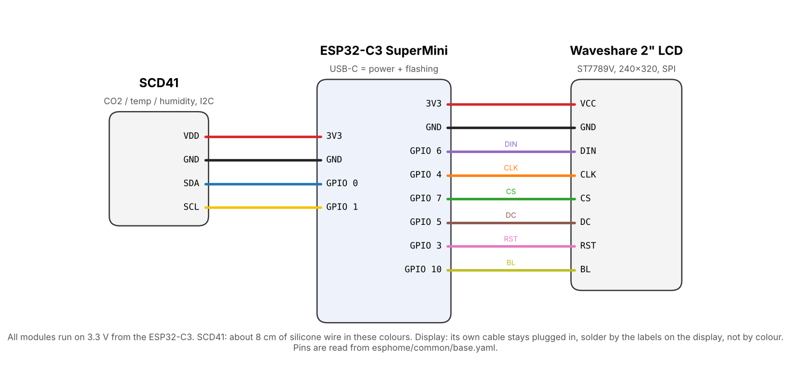

# Wiring

**English** | [Deutsch](de/verdrahtung.md)

All modules run on 3.3 V directly from the ESP32-C3 SuperMini. Power comes in through the USB-C socket of the ESP.

## ESP32-C3 SuperMini to Waveshare 2inch LCD (SPI)

| LCD | ESP32-C3 | Function |
|-----|----------|----------|
| VCC | 3V3      | 3.3 V supply |
| GND | GND      | ground |
| DIN | GPIO6    | SPI MOSI |
| CLK | GPIO4    | SPI clock |
| CS  | GPIO7    | chip select |
| DC  | GPIO5    | data / command |
| RST | GPIO3    | reset |
| BL  | GPIO10   | backlight (PWM, dimmable) |

## ESP32-C3 SuperMini to SCD41 (I2C)

| SCD41 | Wire | ESP32-C3 | Function |
|-------|------|----------|----------|
| VDD   | red    | 3V3      | 3.3 V supply |
| GND   | black  | GND      | ground |
| SDA   | blue   | GPIO0    | I2C data |
| SCL   | yellow | GPIO1    | I2C clock |

The colours are from the silicone wire set in the bill of materials. The display keeps the colours of its own cable: solder by the labels at the display socket, not by colour.

## Why these pins?

* **GPIO2, GPIO8 and GPIO9** are strapping pins of the ESP32-C3 (GPIO8 also drives the blue LED, GPIO9 the BOOT button). They stay free so the board always boots cleanly.
* **GPIO18 and GPIO19** are the USB data lines and stay free as well.
* **GPIO10** is PWM capable and dims the backlight, which enables the night mode.

The diagram is generated by `python tools/wiring.py` directly from `esphome/common/base.yaml`. If you change pins in the YAML, regenerate the diagram.

## Soldering

Every wire is soldered **from below**, on the side that faces the carrier. There is room for the joints and the wires behind the boards, they lie in their own channels.

* **SCD41:** solder the wires to the back of the board (the side without the sensor). Behind the whole board there is 1 mm of air over the whole way it slides in, it only rests on its edges in the rails. Behind the pads a 4.3 mm wide channel is 1.6 mm deep, where the joints pass while the board slides in. Lead-ins at the top of the rails help.
* **ESP32-C3:** solder the wires to the underside (the side with the pin labels, no components). Below the board there is a free space of 1.5 mm, open at the top. The board rests on the middle rail of the spring tongue and on two short posts. The SCD41 wires come in through the notch in the left guide, the display wires from the top under the bridge.
* **Order:** solder the SCD41 wires to the ESP before it goes onto the sled. For the display wires push the cable under the bridge, mark the lengths, slide the ESP out, solder and slide it back in.
* **Taking it apart:** pull the plug off the display. The PH2.0 plug fits through the bridge (opening 18.8 × 6.1 mm), so the ESP comes out completely with all its wires. Or unscrew the carrier and take everything out together.
* **Clean joints:** strip only 1 to 1.5 mm, twist and tin the wire, pre-tin the pads. No-clean flux helps, but keep it away from the sensor opening of the SCD41. Keep the joints flat and cut the wire ends flush.
* **Check:** before the first power-up measure every wire for continuity, above all 3V3 against GND for a short.

## Tips

* **Display:** the supplied PH2.0 cable stays plugged into the display. It folds back at the left wall (seen from the back) and runs across behind the display to the sled and under the bridge, then every wire goes to its pad on the ESP32-C3. Lay it in first, mark the lengths at the pads, then shorten and solder. To take the display out, just pull the plug.
* **SCD41:** 4 wires AWG 30 of about 8 cm. They lie side by side in the narrow wire slot of the sensor carrier and on the back under the lip of the wire clip. No glue needed.
* **Current:** only the sensor and the display draw through these wires (on average about 15 mA and 30 to 60 mA). AWG 30 is plenty, the ESP itself is fed straight from USB.
* Peak current of the SCD41 is about 200 mA for a few milliseconds. The 3.3 V regulator of the SuperMini handles this, keep the supply wires short.
* Test everything on the desk before building it in.
